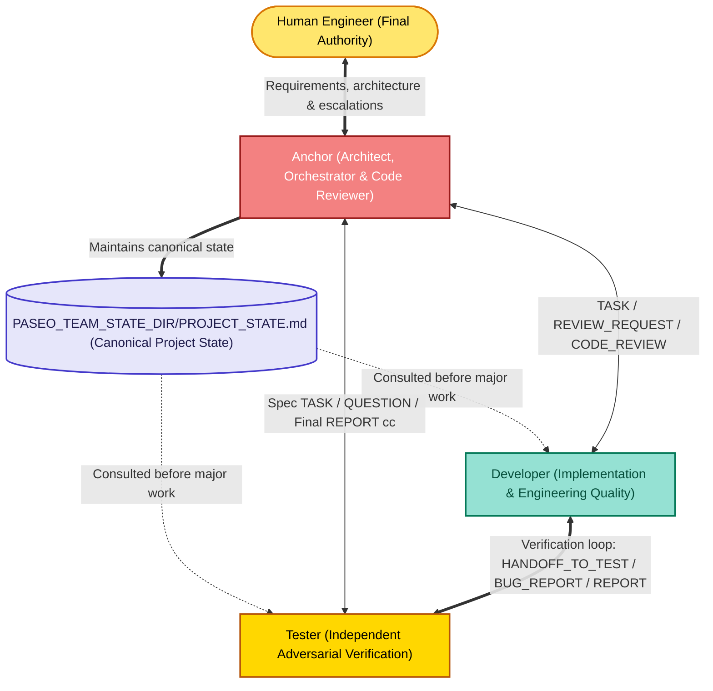

# Multi-Agent Software Development Engineering Framework

A multi-agent system prompt suite for collaborative software engineering operating through **Paseo**. The framework coordinates three specialized agents around a canonical project state to deliver well-architected, independently tested, and peer-reviewed software.

---

## 1. Team Ownership Model

Role boundaries are defined by **ownership and engineering purpose** rather than tool restrictions. Multiple agents may read code, write code, or run commands, but each quality dimension has a single owner:

| Role | Prompt File | Model (`team.yaml`) | Core Ownership | Communication Scope |
| :--- | :--- | :--- | :--- | :--- |
| 🎯 **Anchor** | [`prompts/anchor.md`](prompts/anchor.md) | `antigravity-cli` / `gemini-pro-orchestrator` (Orchestrator Carbon) | Requirements & design alignment, architecture, task breakdown, prioritization, **code review & merge approval**, canonical project state | Aligns with Human; delegates `TASK`s to `Developer` and `Tester`; reviews `Developer` `REVIEW_REQUEST`s; resolves spec/bug disputes |
| ⚙️ **Developer** | [`prompts/developer.md`](prompts/developer.md) | `codex` / `gpt-6.1-sol` | Implementation correctness, code quality, refactoring, debugging, build & dependency management | Receives `TASK` & `CODE_REVIEW` from `Anchor`; runs verification loop with `Tester` (`HANDOFF_TO_TEST` / `BUG_REPORT`); submits `REVIEW_REQUEST` to `Anchor` |
| 🛡️ **Tester** | [`prompts/tester.md`](prompts/tester.md) | `pi` / `deepseek/deepseek-flash` | Independent verification (test plans, unit/integration/e2e suites, edge/failure cases, regression tests, bug isolation) | Receives spec `TASK` & clarifies acceptance criteria with `Anchor`; verifies `Developer` handoffs (`BUG_REPORT` / `REPORT`, cc `Anchor` on final `REPORT`) |

Shared team-wide norms, quality gates, and message semantics are defined in [`prompts/sde-team-common.md`](prompts/sde-team-common.md).

---

## 2. Architecture & Agent Workflow

### 2.1 System Ownership & Communication Topology

**Anchor** maintains the canonical `$PASEO_TEAM_STATE_DIR/PROJECT_STATE.md`, breaks work into scoped tasks, and acts as the final code-review gate before merging. **Tester** derives tests from the specification in parallel with **Developer**'s implementation and runs a tight verification loop with **Developer** prior to review.



---

### 2.2 Feature Delivery & Verification Sequence

The sequence below illustrates a standard feature or bugfix cycle from specification to merge approval:

```mermaid
sequenceDiagram
    autonumber
    participant H as Human
    participant A as Anchor
    participant D as Developer
    participant T as Tester

    H->>+A: Propose feature or change
    A->>A: Clarify scope, design & acceptance criteria
    A->>+D: TASK (Requirements, constraints & deliverables)
    A->>+T: TASK (Same spec & acceptance criteria)

    par Implementation & Spec-Driven Test Design
        D->>D: Implement feature & smoke check
    and
        T->>T: Design & draft tests from spec
    end

    D->>T: HANDOFF_TO_TEST (Changes, run commands & interfaces)

    alt Defect or spec mismatch detected
        T-->>D: BUG_REPORT (Minimal reproduction & evidence)
        D->>D: Fix root cause
        D->>T: Re-handoff for verification
    end

    T-->>-D: REPORT (Verification Passed, cc Anchor)
    D->>A: REVIEW_REQUEST (Summary, diff & test status)
    A->>A: Inspect diff, review code & tests, run checks

    alt Blocking review comments
        A-->>D: CODE_REVIEW (Changes Requested)
        D->>D: Address blocking feedback
        D->>T: Re-verify if behavior changed
        D->>A: Updated REVIEW_REQUEST
    end

    A-->>-D: CODE_REVIEW (Approved)
    A->>A: Update PASEO_TEAM_STATE_DIR/PROJECT_STATE.md & approve merge
    A-->>-H: Feature delivered & verified
```

---

## 3. Semantic Message Protocol

Agents communicate through Paseo using structured message types defined in [`prompts/sde-team-common.md`](prompts/sde-team-common.md):

| Message Type | Typical Sender → Recipient | Purpose |
| :--- | :--- | :--- |
| `TASK` | `Anchor` → `Developer` / `Tester` | Assign a scoped implementation or verification task with acceptance criteria and priority. |
| `REPORT` | `Developer` / `Tester` → `Anchor` / `Developer` | Report implementation status, blockers, or verification results (cc `Anchor` on final test reports). |
| `QUESTION` | Any Agent → `Anchor` / Peer | Request clarification on requirements, specifications, interfaces, or constraints. |
| `CHALLENGE` | Any Agent → `Anchor` / Peer | Challenge an ambiguous requirement, flawed design assumption, or invalid test expectation. |
| `HANDOFF_TO_TEST` | `Developer` → `Tester` | Hand off implemented changes, run commands, interfaces, and covered criteria for verification. |
| `BUG_REPORT` | `Tester` → `Developer` | Report an isolated defect, broken invariant, or spec mismatch with minimal reproduction. |
| `REVIEW_REQUEST` | `Developer` → `Anchor` | Submit verified changes for code review and merge approval. |
| `CODE_REVIEW` | `Anchor` → `Developer` | Deliver code and test review verdict (`Approved` / `Changes Requested` / `Rejected`). |

---

## 4. Persistent Team State (`PASEO_TEAM_STATE_DIR`)

When imported by the **Paseo** plugin, persistent agent communication records and project state are stored outside the product's source tree (for example, under a hidden directory such as `.agents/<team>/`) so framework artifacts never pollute the target repository.

- The Paseo plugin exports the directory path via the **`PASEO_TEAM_STATE_DIR`** environment variable.
- Agents resolve `PASEO_TEAM_STATE_DIR` at runtime to read and write `$PASEO_TEAM_STATE_DIR/PROJECT_STATE.md` (seeded from [`templates/PROJECT_STATE.md`](templates/PROJECT_STATE.md)) and any persisted coordination records.
- If `PASEO_TEAM_STATE_DIR` is unset or missing, agents stop and escalate rather than creating ad-hoc state files inside the project tree.

---

## 5. Repository Structure

```text
MA-SDE-Framework/
├── team.yaml                      # Paseo 3-agent team definition and model configuration
├── README.md                      # Framework architecture, roles, and usage guide
├── prompts/
│   ├── sde-team-common.md         # Shared team protocol, integrity rules, quality gates & messages
│   ├── anchor.md                  # Anchor: tech lead, architect, orchestrator & code reviewer
│   ├── developer.md               # Developer: production implementation & engineering quality
│   └── tester.md                  # Tester: independent spec-driven verification & testing
└── templates/
    └── PROJECT_STATE.md           # Template seeded into $PASEO_TEAM_STATE_DIR by the Paseo plugin
```

> **Note:** The framework does not prescribe a source/test layout. Production code and tests follow the target project's existing conventions; for new projects, Anchor defines the layout in `$PASEO_TEAM_STATE_DIR/PROJECT_STATE.md`.

---

## 6. Definition of Done

A substantial task is complete only when:

1. Agreed requirements and acceptance criteria are satisfied.
2. **Tester** has issued a verification `REPORT` with status `Passed` (unless explicitly waived by **Anchor** for a trivial change).
3. **Anchor** has inspected the diff and issued a `CODE_REVIEW` with verdict `Approved`.
4. Build, linter (if configured), and test suites are green after the final edit.
5. `$PASEO_TEAM_STATE_DIR/PROJECT_STATE.md` is updated with task status, design decisions, and remaining risks.

---

## 7. Role-Boundary Litmus Test

When assigning or reviewing work across the workflow, apply the three-question ownership test:

1. **WHO decides what to build, how it fits together, and whether it is good enough to merge?** → `Anchor`
2. **WHO builds and maintains the production implementation?** → `Developer`
3. **WHO independently proves the implementation satisfies its specification (or finds where it breaks)?** → `Tester`

---

## 8. Usage

1. Configure your **Paseo** plugin to import [`team.yaml`](team.yaml) and export `PASEO_TEAM_STATE_DIR` pointing to the persistent team-state directory (e.g., `.agents/<team>/`), seeding [`templates/PROJECT_STATE.md`](templates/PROJECT_STATE.md) as `$PASEO_TEAM_STATE_DIR/PROJECT_STATE.md` if not already present.
2. Load [`team.yaml`](team.yaml) into **Paseo** (`workspace` is automatically replaced with your current workspace name on load), and optionally set `goal` or describe your project objective directly to **Anchor**.
3. **Anchor** will collaborate with you to refine requirements and architecture in `$PASEO_TEAM_STATE_DIR/PROJECT_STATE.md`, then coordinate **Developer** and **Tester** through implementation, verification, and code review.
